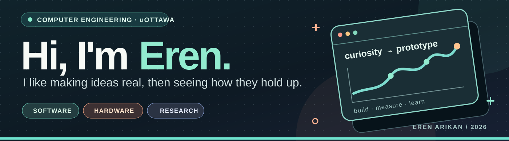

<a href="#lailow">LAILOW</a> &nbsp; / &nbsp; <a href="#apogee">APOGEE</a> &nbsp; / &nbsp; <a href="#engineering">ENGINEERING</a>

I'm **Eren Arikan**, a Computer Engineering student at **the University of Ottawa**. I work across **software engineering and hardware/embedded systems**, from analytics and simulation to firmware, sensors and telemetry. I'm looking for internships in both, with projects that make my code, design decisions and validation easy to inspect.

**Python · C · C++ · ARM assembly**

## LAILOW

**My flagship project · campaign intelligence**

I'm developing LAILOW to connect campaign metrics, visual analysis and question answering. My public case study pairs a prototype walkthrough with a **separate, runnable Python analytics demo** using fictional records. I keep the original application source and business data private.

My prototype interface, shown with synthetic data.

**[Explore LAILOW ↗](https://github.com/erudaperu/LAILOW-showcase)** · [Run the demo](https://github.com/erudaperu/LAILOW-showcase#try-the-synthetic-demo) · [Architecture](https://github.com/erudaperu/LAILOW-showcase#architecture)

## APOGEE

**My solo hardware + software project · in progress**

Concept art for my planned model rocket.

I'm defining an instrumented model rocket around a certified commercial motor, connecting **CAD and avionics** with **C/C++ firmware, ground software and offline analysis**.

**Current stage: planning and requirements.** My first milestone combines a system concept, a sensor-data contract and a reproducible replay tool. I haven't built the vehicle or flight system yet.

**[Explore APOGEE ↗](https://github.com/erudaperu/apogee)** · [Architecture](https://github.com/erudaperu/apogee/tree/main/docs/architecture) · [Roadmap](https://github.com/erudaperu/apogee/tree/main/docs/roadmap)

## More engineering

**[STM32 motor control & telemetry ↗](https://github.com/erudaperu/CEG3536_Lab)**  
In this university team project, I worked on an STM32L552 system using C and ARM assembly. I document acquisition, encoder feedback, PWM, telemetry, host checks and recorded board results.

**[C++ numerical simulation ↗](https://github.com/erudaperu/Black-Hole-Simulation)**  
I built a compact C++17 simulation of motion under a softened central force, with documented assumptions, build instructions and trajectory output.
