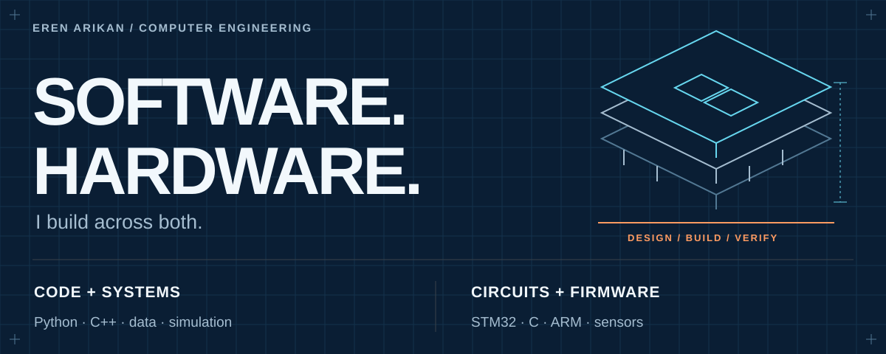

  

<strong>Build the system. Measure what it does. Explain the tradeoffs.</strong>

I’m **Eren Arikan**, a Computer Engineering student at the **University of Ottawa**. My projects span embedded control, C++ simulation and data-driven software. I care about clear interfaces, useful validation and documentation that lets someone else inspect the work quickly.

### 01 / Flagship · LAILOW

**Campaign intelligence, made inspectable.** LAILOW explores a workflow for bringing campaign metrics, visual analysis and question answering into one place. The [public case study](https://github.com/erudaperu/LAILOW-showcase) gives a product walkthrough, a conceptual architecture and a runnable analytics demo with **fictional data only**. The full project source and business data stay private.

**[Explore LAILOW](https://github.com/erudaperu/LAILOW-showcase)** · [Run the synthetic demo](https://github.com/erudaperu/LAILOW-showcase#try-the-synthetic-demo) · [See the architecture](https://github.com/erudaperu/LAILOW-showcase#architecture)

### 02 / Embedded systems · STM32 Motor Control & Telemetry

**C + ARM assembly on STM32L552 / Cortex-M33.** An event-driven motor controller with ADC/DMA acquisition, encoder feedback, PWM, emergency-stop handling and serial telemetry. The repository documents the architecture, Linux host checks, target harness and recorded board results, including the measurements that remain open. Built as a University of Ottawa team project.

**[Explore the system](https://github.com/erudaperu/CEG3536_Lab)** · [Review validation evidence](https://github.com/erudaperu/CEG3536_Lab#validation-evidence)

### 03 / Simulation · Black Hole Simulation

**C++17 numerical motion in a compact, inspectable program.** A particle evolves under a softened central attraction; the repository includes the model assumptions, build steps, sample trace and a trajectory visualization.

**[Explore the simulation](https://github.com/erudaperu/Black-Hole-Simulation)** · [See the trajectory](https://github.com/erudaperu/Black-Hole-Simulation/blob/main/docs/trajectory.svg)

---

**What I work with:** Python · C · C++ · ARM assembly · embedded systems · test harnesses · numerical simulation · data analysis

For the fastest review, start with **LAILOW’s quick walkthrough**, then the **STM32 architecture and validation table**. The repositories above distinguish demonstrated behaviour from future work and list the commands needed to inspect or run each project.
