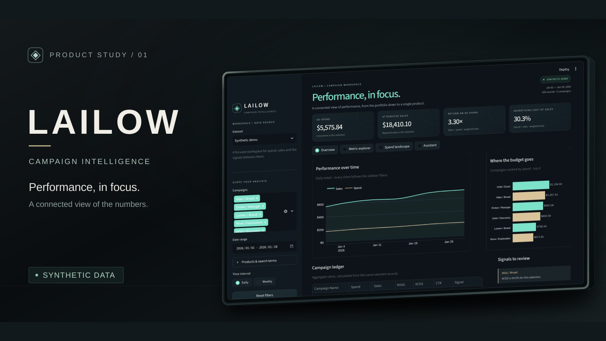
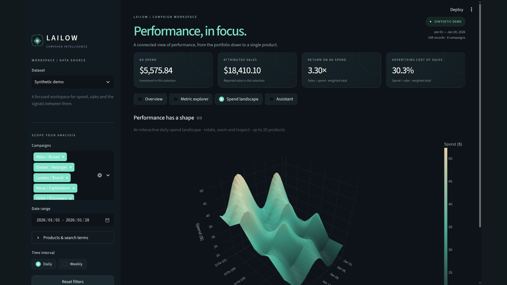

<a href="#lailow">LAILOW</a> &nbsp; / &nbsp; <a href="#research">RESEARCH</a> &nbsp; / &nbsp; <a href="#apogee">APOGEE</a> &nbsp; / &nbsp; <a href="#engineering">ENGINEERING</a>

I'm **Eren Arikan**, a Computer Engineering student at **the University of Ottawa**. I work across **software engineering and hardware/embedded systems**, from analytics and simulation to firmware, sensors and telemetry. I'm looking for internships in both, with projects that make my code, design decisions and validation easy to inspect.

**Python · C · C++ · ARM assembly**

## LAILOW

**My flagship project · campaign intelligence**

I'm developing LAILOW to connect campaign metrics, visual analysis and question answering. My public case study pairs a prototype walkthrough with a **separate, runnable Python analytics demo** using fictional records. I keep the original application source and business data private.

 Product cover built around the working prototype. <a href="https://github.com/erudaperu/LAILOW-showcase">Open the case study ↗</a>

 The real 3D spend landscape in the prototype, using synthetic records. <a href="https://github.com/erudaperu/LAILOW-showcase/blob/main/assets/dashboard-landscape.jpg">View full image ↗</a>

**[Explore LAILOW ↗](https://github.com/erudaperu/LAILOW-showcase)** · [Run the demo](https://github.com/erudaperu/LAILOW-showcase#try-the-synthetic-demo) · [Architecture](https://github.com/erudaperu/LAILOW-showcase#architecture)

## Olive Knot AI | Award-winning research

**National second place in Software — TÜBİTAK 2204-A (2022)**, following regional first place. I built an olive knot image classifier and mobile prototype, and studied 12 olive saplings across four comparison groups over four months.

<table><tr><td width="55%"></td><td width="45%"><strong>Awarded for the work, with the research open to inspect.</strong>  The original exhibition photos, mobile screens, plant and lab images, training chart, and English research poster are all on the <a href="https://github.com/erudaperu/erudaperu/tree/main/research/olive-knot-ai">project page</a>.  <a href="research/olive-knot-ai/AWARDS_AND_SOURCES.md">Official result and sources ↗</a></td></tr></table>

Award visuals supplied by me; the [official result](research/olive-knot-ai/AWARDS_AND_SOURCES.md) documents the national second-place Software award.

**[Explore the full project ↗](https://github.com/erudaperu/erudaperu/tree/main/research/olive-knot-ai)** · [English poster](research/olive-knot-ai/media/public-research-poster.pdf) · [Presentation](research/olive-knot-ai/media/public-presentation.pdf)

## APOGEE

**My solo hardware + software project · in progress**

I'm defining an instrumented model rocket around a certified commercial motor, connecting **CAD and avionics** with **C/C++ firmware, ground software and offline analysis**.

<table><tr><td width="58%" valign="top"> My model rocket and avionics concept. <a href="https://github.com/erudaperu/apogee">Explore the project ↗</a></td><td width="42%" valign="top"> The planned measurement-to-analysis path.  <strong>Current stage:</strong> planning and requirements. My first milestone combines a system concept, a sensor-data contract and a reproducible replay tool. I haven't built the vehicle or flight system yet.</td></tr></table>

**[Explore APOGEE ↗](https://github.com/erudaperu/apogee)** · [Architecture](https://github.com/erudaperu/apogee/tree/main/docs/architecture) · [Roadmap](https://github.com/erudaperu/apogee/tree/main/docs/roadmap)

## More engineering

**[STM32 motor control & telemetry ↗](https://github.com/erudaperu/CEG3536_Lab)**  
In this university team project, I worked on an STM32L552 system using C and ARM assembly. I document acquisition, encoder feedback, PWM, telemetry, host checks and recorded board results.

**[C++ numerical simulation ↗](https://github.com/erudaperu/Black-Hole-Simulation)**  
I built a compact C++17 simulation of motion under a softened central force, with documented assumptions, build instructions and trajectory output.
