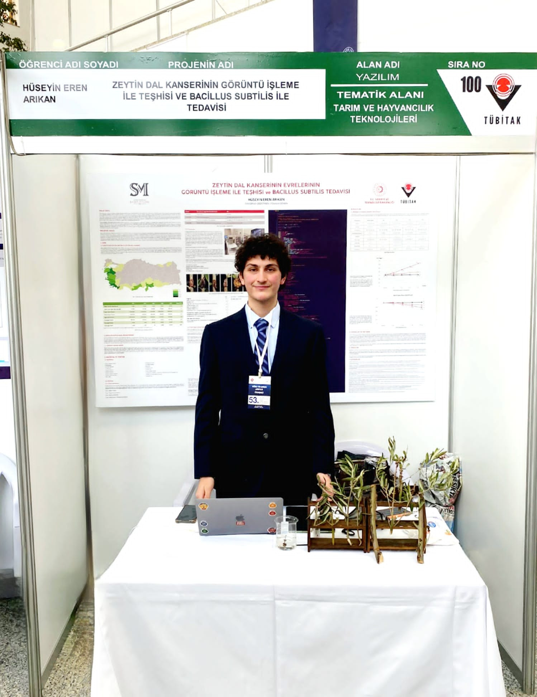
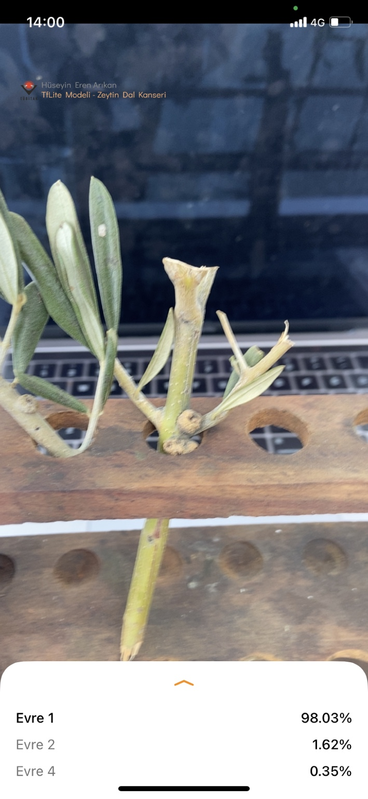
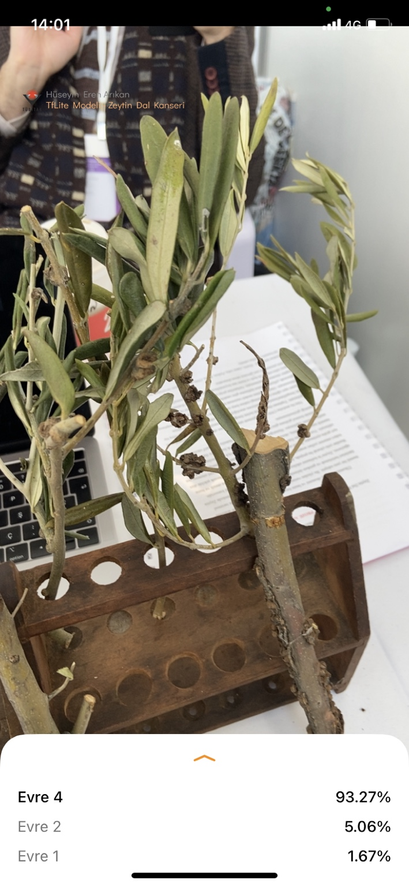
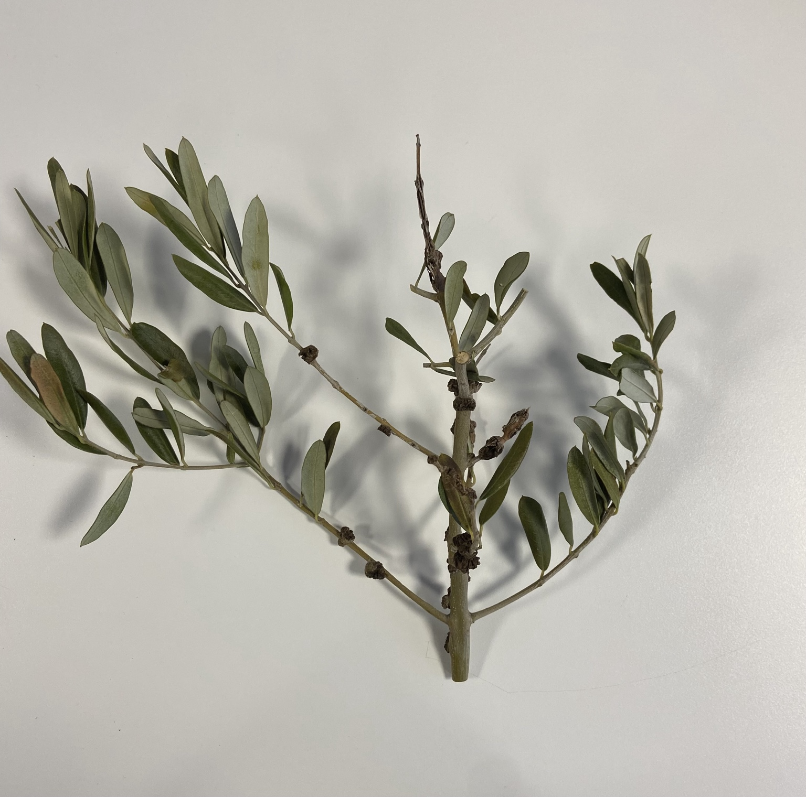
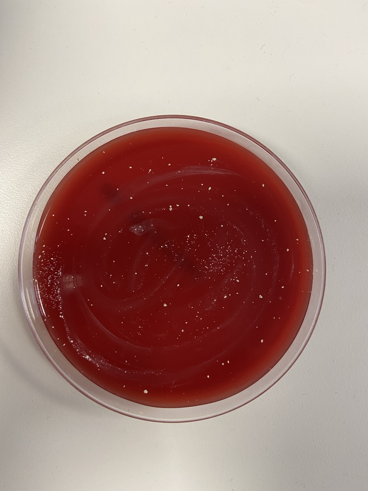
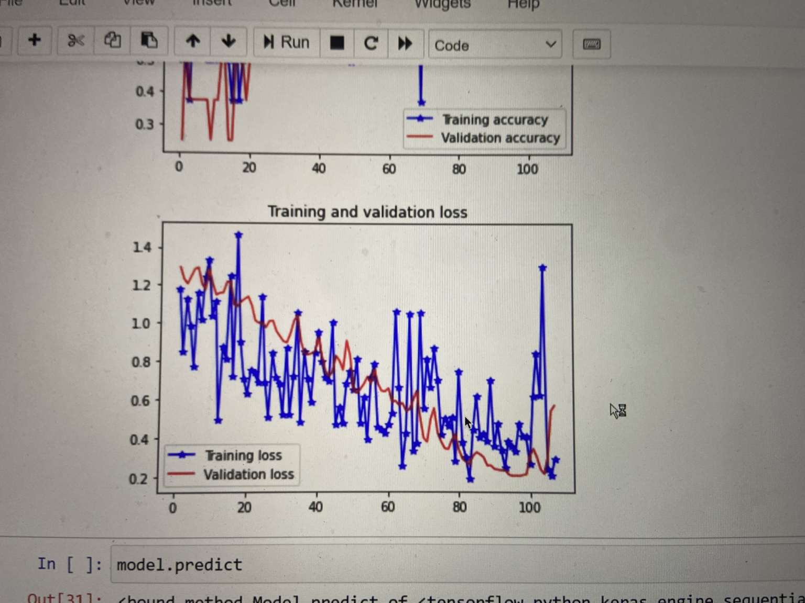
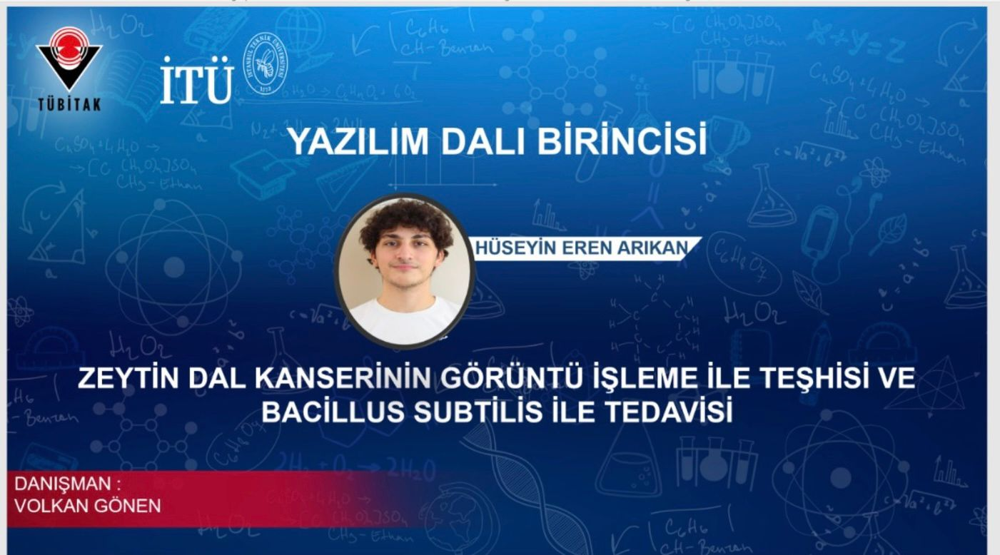

# Olive Knot AI — visual research presentation

This compact web presentation uses the actual 2022 exhibition and prototype images. A photo-based [eight-slide PDF](media/public-presentation.pdf) and [PowerPoint](media/public-presentation.pptx) are available for offline viewing. For the original poster layout, open the [public poster PDF](media/public-research-poster.pdf), which removes source code and detailed methods from the file itself.

## 1. The project in the room

My 2022 project brought together a four-stage olive knot image classifier, a mobile demonstration and an olive-sapling study. The [national second-place Software result](AWARDS_AND_SOURCES.md) followed regional first-place recognition.

## 2. Research question

Could a plant image help identify the visible stage of olive knot disease? I trained a CNN-based classifier and displayed stage predictions in a phone app. This was a research prototype, not a certified diagnostic tool.

## 3. Prototype evidence

| Stage 1 example | Stage 4 example |
|---|---|
|  |  |

The screens show **98.03%** and **93.27%** confidence for these individual examples. The poster separately reports **88.33%** classification accuracy; no independent external test result is claimed here.

## 4. Plant and laboratory work

| Olive specimen | Laboratory sample |
|---|---|
|  |  |

The poster describes 12 saplings in four groups, observed for about four months. Its reported treatment observations are preliminary, and the detailed protocol is kept private.

## 5. Training record and award

This graphic documents the **regional first-place** Software result. TÜBİTAK's [archived official final list](https://web.archive.org/web/20240520125501id_/https://tubitak.gov.tr/sites/default/files/2750/final_sonuc_web_son.pdf) documents the separate **national second-place** Software award.

## 6. What is public

The [public poster PDF](media/public-research-poster.pdf) retains the original research presentation's look and result figures while obscuring source code, doses, detailed procedures and model/data workflow. My implementation, weights, datasets and unredacted poster are private. [Rights and media credits](MEDIA_CREDITS.md).
