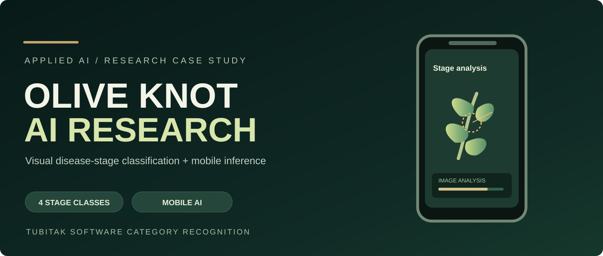
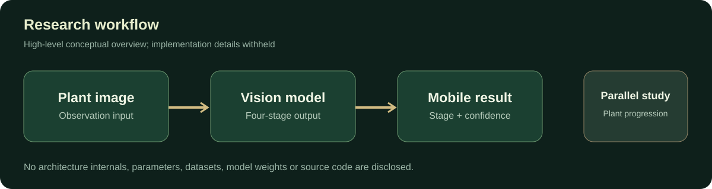
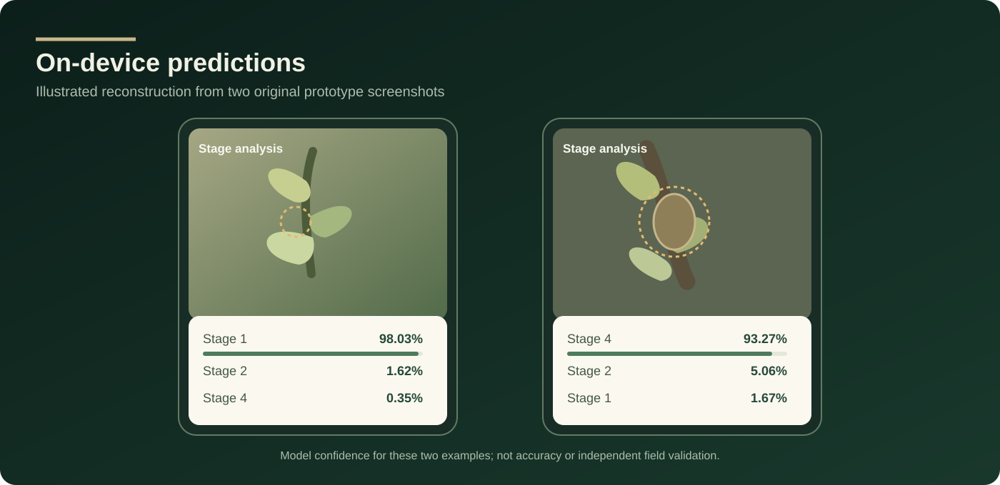

# Olive Knot AI | National award-winning computer vision

**National Second Place in Software — TÜBİTAK 2204-A (2022)** · **Regional first place** · **Regeneron ISEF-linked selection pathway**

**25,095 project submissions · 37,283 participating students · 216 national-final projects**  
Official 2022 competition-wide figures across all 12 fields; the second-place award is in Software. <a href="https://tubitak.gov.tr/tr/haber/53-lise-ogrencileri-arastirma-projeleri-yarismasinin-kazananlari-odullerini-cumhurbaskani-erdoganin-elinden-aldi">Source: TÜBİTAK</a>.

An independent research project by **Hüseyin Eren Arıkan (Eren Arikan)**, exploring computer-vision classification of olive knot disease, a mobile prediction prototype, and scientific observation of how plant disease progressed under comparison conditions.

> **National recognition:** TÜBİTAK's official [2022 final awards list](https://tubitak.gov.tr/sites/default/files/2750/final_sonuc_web_son.pdf) names *Hüseyin Eren Arıkan*, supervising teacher *Volkan Gönen*, and the olive knot project in the **Software** category with **İKİNCİLİK ÖDÜLÜ** (second-place award). This is a **national** result.

## Why this achievement matters

The TÜBİTAK 2204-A high-school research competition is a long-running national science and engineering program. In **2022**, it received **25,095 project submissions** from **37,283 students** across Türkiye and all **12 competition fields**. Following regional judging, **216 projects** advanced to the national final. These are competition-wide totals, not the size of the Software category alone. <a href="https://tubitak.gov.tr/tr/haber/53-lise-ogrencileri-arastirma-projeleri-yarismasinin-kazananlari-odullerini-cumhurbaskani-erdoganin-elinden-aldi">Official competition statistics and ceremony report</a>.

**Presidential ceremony:** The 2022 national awards were held at the **Presidential Complex in Ankara** with President Recep Tayyip Erdoğan present. The official report specifies that the President personally handed out first-place awards, while ministers and the TÜBİTAK president presented second-place and other prizes. That official distinction is retained in this portfolio.

**Regeneron ISEF connection:** TÜBİTAK separately reassesses national award-winning projects to choose Türkiye's representatives at international fairs, including **Regeneron ISEF**. This project is part of that national-award selection pathway; no unsupported claim of an ISEF medal or international attendance is made. [TÜBİTAK report](https://tubitak.gov.tr/tr/haber/53-lise-ogrencileri-arastirma-projeleri-yarismasinin-kazananlari-odullerini-cumhurbaskani-erdoganin-elinden-aldi).

## At a glance

| Domain | Result |
|---|---|
| **Computer vision** | A CNN-based classifier distinguishing **four disease stages**, developed with TensorFlow/Keras |
| **Mobile inference** | Working phone prototype displaying classifications and per-image confidence scores |
| **Reported evaluation** | **88.33% accuracy**, as reported in the original 2022 research poster |
| **Experimental research** | **12 olive saplings**, four comparison groups and four months of observations |
| **Recognition** | TÜBİTAK **2022 national second place in Software**, following regional first-place recognition |

## Research concept

The question was whether imagery could help identify the **visible stage** of olive knot disease in a form that could be used without specialized laboratory equipment. A parallel plant study investigated disease progression and the potential role of *Bacillus subtilis* under experimental conditions. The work is a research prototype, **not** a validated commercial diagnosis or treatment.

## Mobile prototype

The original app screenshots show stage-1 and stage-4 predictions, including **98.03%** and **93.27%** confidence in two respective examples. These are **prediction confidences**, distinct from the research poster's reported overall accuracy.

## Presentation and photographic archive

I have a curated public research presentation made from my **original exhibition photos, award graphic, plant photographs, mobile screenshots and training curve**. A **source-free [web presentation](PRESENTATION.md)** is provided here, with [award records and citations](AWARDS_AND_SOURCES.md) and [media disclosures](MEDIA_CREDITS.md). The PDF, PowerPoint and selected full-resolution photo assets are prepared separately for repository upload; the GitHub connector does not currently support attaching those binary files.

The original full 2022 poster is **not** redistributed here because it contains code screenshots and detailed experimental procedures. This is an intentionally limited public release.

## Intellectual property

**© 2026 Hüseyin Eren Arıkan. All rights reserved for original owned materials.** This repository does not grant an open-source licence to the unpublished software, model weights, data, or implementation. Institutional marks, official documents and photos owned by others remain with their rights holders. See [LICENSE.md](LICENSE.md) before reusing any material.

**Researcher and software developer:** Hüseyin Eren Arıkan  
**Supervising teacher (2022 research):** Volkan Gönen

[Back to my GitHub profile](https://github.com/erudaperu)
