<a href="media/exhibition-booth.jpg">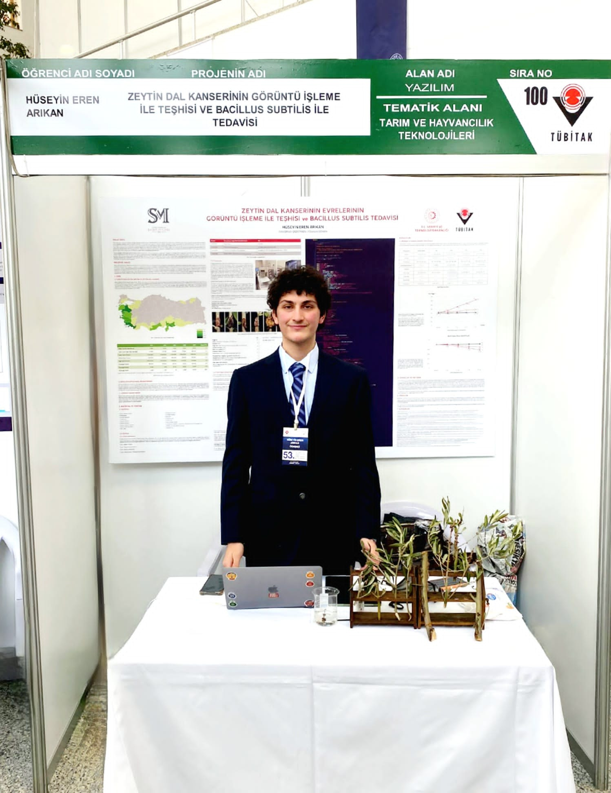</a>

At the 2022 TÜBİTAK exhibition with the research poster, olive specimens and working prototype. [View original photo](media/exhibition-booth.jpg).

# Olive Knot AI — computer vision and plant research

**National second place in Software, TÜBİTAK 2204-A (2022)** · Regional first place in Software

I built a research prototype to classify the visible stage of olive knot disease from plant images, put the classifier into a mobile app, and studied disease progression in olive saplings over four months. This page gathers the exhibition photographs, award visuals, prototype screens, specimen and laboratory images, training chart, and an English edition of my 2022 research poster. The original Turkish poster remains in my private archive.

**[Explore the full English poster (PDF)](media/public-research-poster.pdf)** · [Presentation (PDF)](media/public-presentation.pdf) · [PowerPoint](media/public-presentation.pptx) · [Award evidence](AWARDS_AND_SOURCES.md) · [Media and rights](MEDIA_CREDITS.md)

## Research poster in English

<a href="media/public-research-poster.pdf">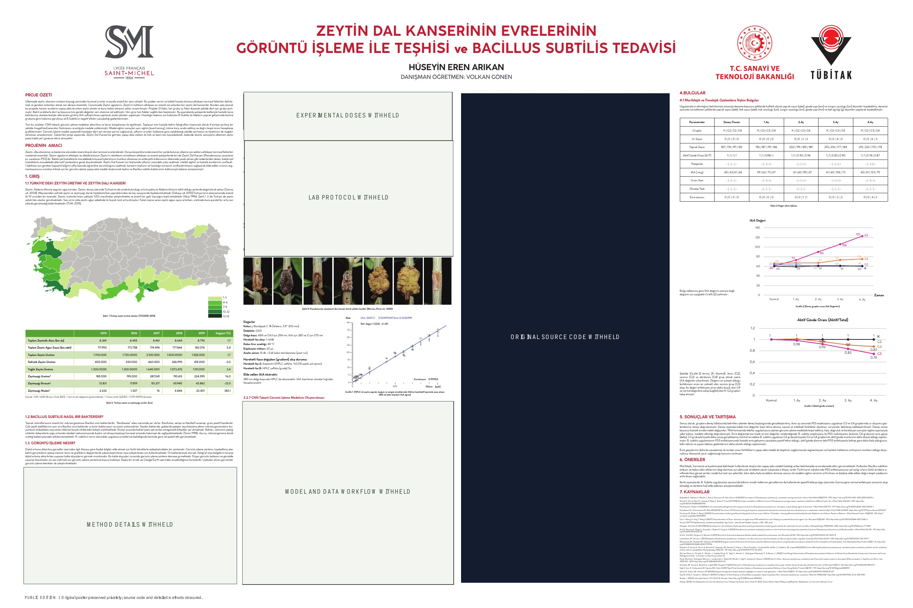</a>

[Open the full-size PDF](media/public-research-poster.pdf). This English edition follows the original poster's layout and preserves its figures, data, methods and historical code screenshot. The code image represents development work from 2022, **not the finished product**. The original Turkish PDF remains private.

## What I built and investigated

| Workstream | Public evidence | Outcome |
|---|---|---|
| Image classification | Four visible disease-stage classes; CNN developed with TensorFlow/Keras | The 2022 poster reports **88.33% classification accuracy**. This is a self-reported research result, not an independently validated field score. |
| Mobile prototype | Real stage-1 and stage-4 app screenshots below | A phone interface displayed ranked stage predictions and confidence for an image. |
| Plant study | Olive specimens, laboratory image, original poster's result plots | **12 olive saplings**, four comparison groups, approximately four months of observation. The reported plant findings are preliminary. |

The research question was whether a phone image could give a useful, fast indication of **visible disease stage**. I also examined how the disease progressed under comparison conditions involving *Bacillus subtilis*. The app was a research demonstration; it was not a certified diagnosis, field-validated product, or proven treatment.

## See the project at the exhibition

<table><tr><td width="55%"><a href="media/research-demonstration.jpg">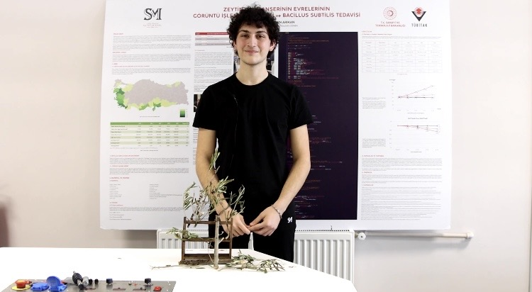</a> Explaining the project with a specimen and the original poster. <a href="media/research-demonstration.jpg">Full image</a></td><td width="45%"><a href="media/regional-first-place-graphic.jpg">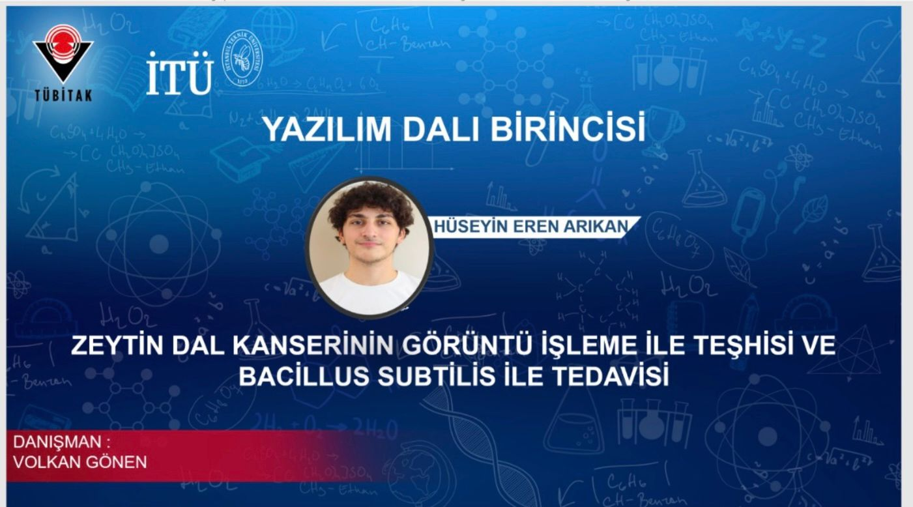</a> The supplied <strong>regional first-place</strong> announcement. The national second-place result is documented separately in the <a href="AWARDS_AND_SOURCES.md">official final list</a>. <a href="media/regional-first-place-graphic.jpg">Full image</a></td></tr></table>

## Award visuals

<table><tr><td width="55%"><a href="media/award-portrait-supplied.jpg">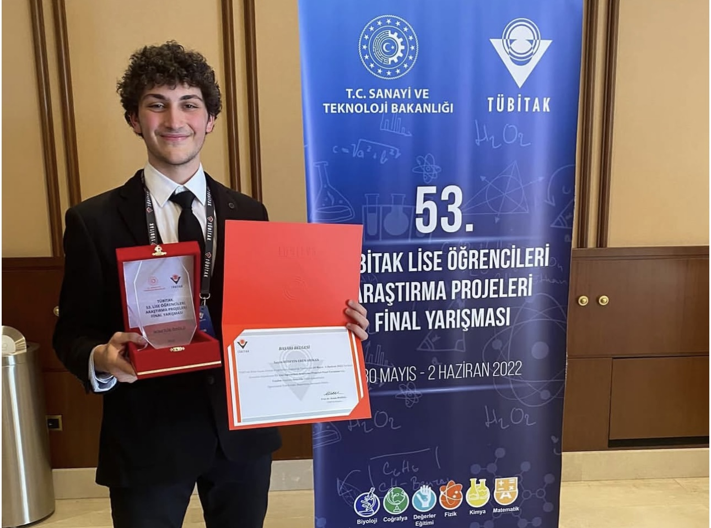</a> Award portrait supplied for this showcase. <a href="media/award-portrait-supplied.jpg">Open image</a></td><td width="45%"><a href="media/award-ceremony-supplied.webp">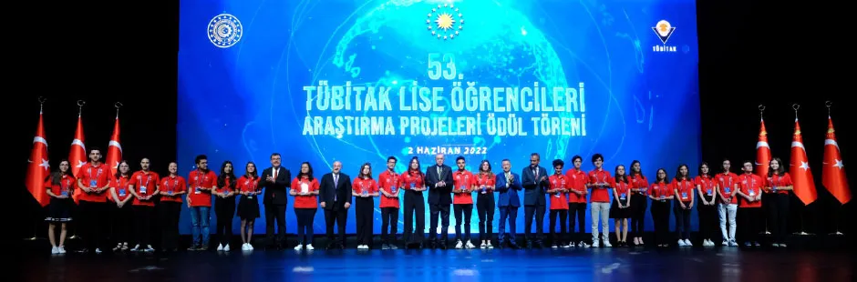</a> 2022 award-ceremony stage image supplied for this showcase. <a href="media/award-ceremony-supplied.webp">Open image</a></td></tr></table>

The [official TÜBİTAK final list](AWARDS_AND_SOURCES.md) documents the **national second-place Software award**. These two newly supplied visuals have no camera provenance attached, so they do not establish who personally presented the prize.

## Mobile prototype — real screens

<table><tr><td width="50%"><a href="media/mobile-stage-1.jpg">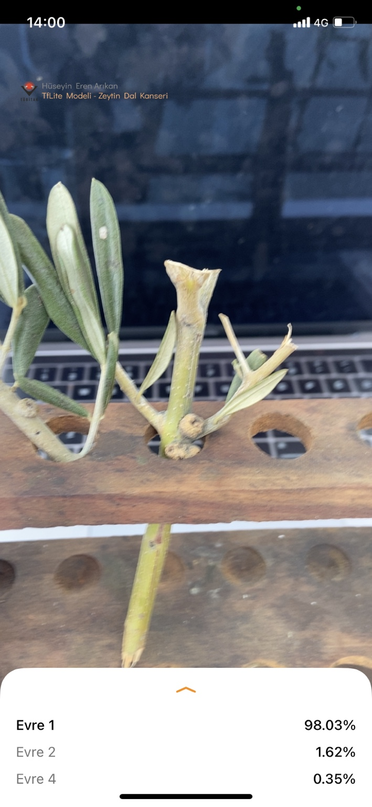</a> Stage-1 example: <strong>98.03% prediction confidence</strong> for this image. <a href="media/mobile-stage-1.jpg">Full screen</a></td><td width="50%"><a href="media/mobile-stage-4.jpg">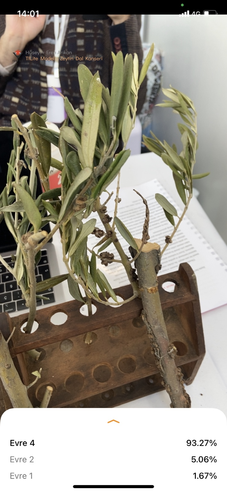</a> Stage-4 example: <strong>93.27% prediction confidence</strong> for this image. <a href="media/mobile-stage-4.jpg">Full screen</a></td></tr></table>

These percentages are the prototype's **per-image predictions**, separate from the poster's reported overall accuracy. They should not be read as clinical or agricultural reliability estimates.

<a href="media/mobile-app-icon.png">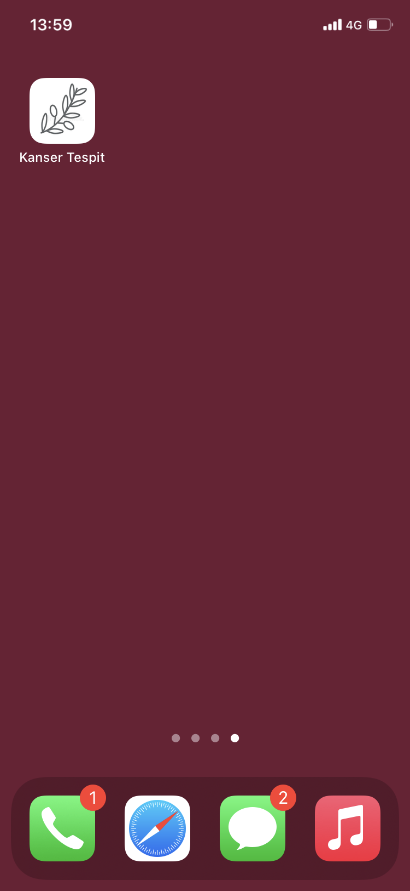</a>

The original “Kanser Tespit” app icon on the phone home screen. [Full image](media/mobile-app-icon.png).

## Research images and training record

<table><tr><td width="50%"><a href="media/olive-branch-specimen.jpg">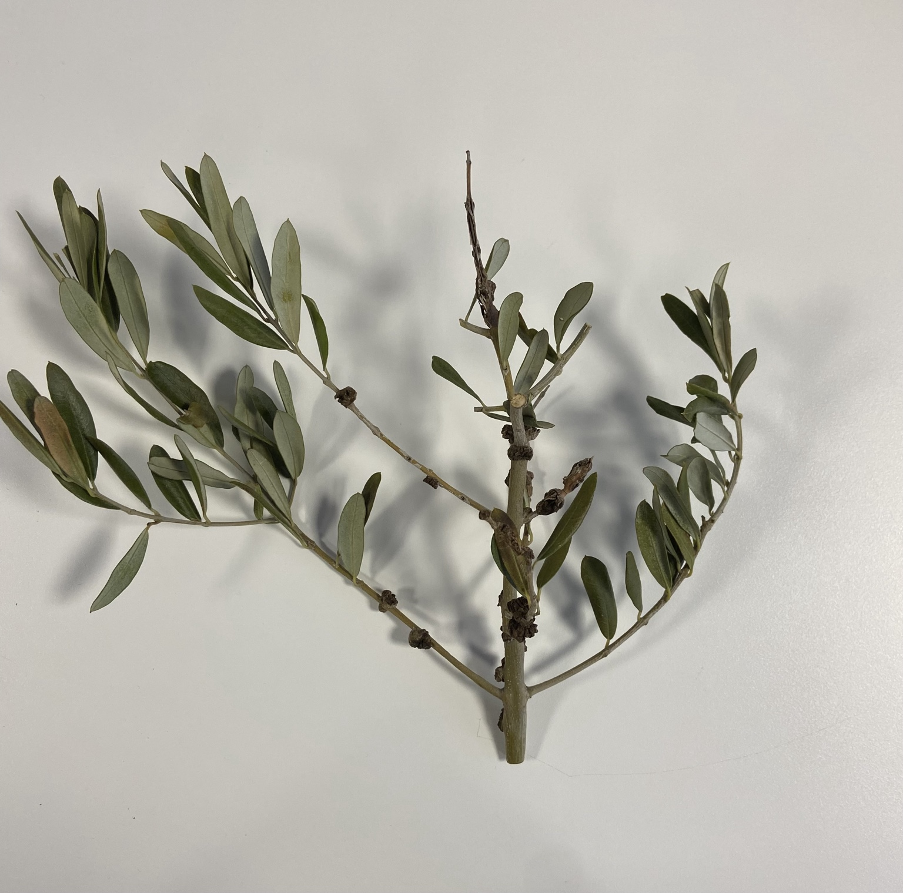</a> Olive branch specimen. <a href="media/olive-branch-specimen.jpg">Full image</a></td><td width="50%"><a href="media/laboratory-sample.jpg">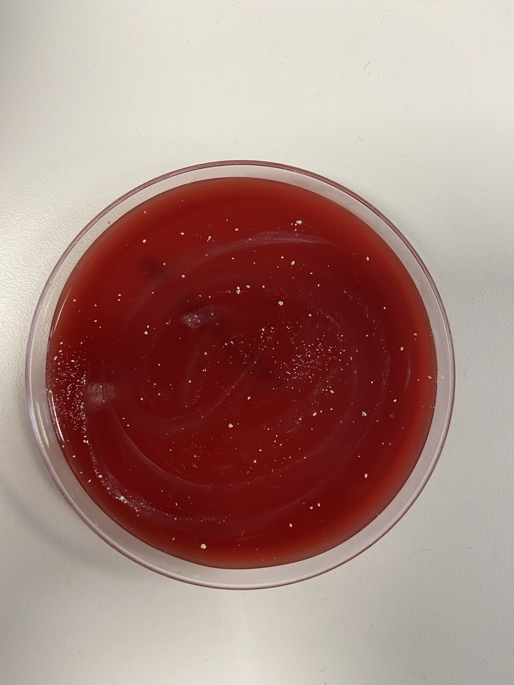</a> Laboratory sample from the plant study. <a href="media/laboratory-sample.jpg">Full image</a></td></tr></table>

<a href="media/training-validation-chart.jpg">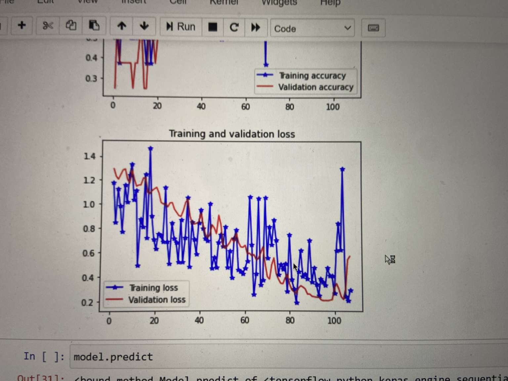</a>

Original training and validation chart. The visible variation is part of the experiment record; it is not evidence of performance on an independent external dataset. [Full image](media/training-validation-chart.jpg).

## Recognition and context

TÜBİTAK's [archived official 2022 national-final list](https://web.archive.org/web/20240520125501id_/https://tubitak.gov.tr/sites/default/files/2750/final_sonuc_web_son.pdf) records **Hüseyin Eren Arıkan**, advisor **Volkan Gönen**, and this project as an **İkincilik Ödülü** (second-place award) in **Yazılım** (Software). The [2022 TÜBİTAK competition report](https://tubitak.gov.tr/tr/haber/53-lise-ogrencileri-arastirma-projeleri-yarismasinin-kazananlari-odullerini-cumhurbaskani-erdoganin-elinden-aldi) reports **25,095 project submissions**, **37,283 participating students** and **216 national-final projects** across all 12 fields. Those totals are competition-wide, not a Software-only ranking.

The 2022 national awards ceremony took place at the Presidential Complex with President Recep Tayyip Erdoğan present. TÜBİTAK says he presented first-place prizes; ministers and TÜBİTAK leadership presented second-place prizes. National award winners could be considered in a further **Regeneron ISEF** selection process; a national prize did not automatically mean ISEF participation. [Award details and source notes](AWARDS_AND_SOURCES.md).

## Public release and rights

The source repository, finished implementation, model weights and training-image dataset remain private. The English poster shows the original research methods and a historical code screenshot; that screenshot is a development representation, not the finished implementation. The original user-supplied image files are unchanged. The poster's figures and numerical results are retained in the English edition.

**© 2026 Hüseyin Eren Arıkan. All rights reserved for original materials I own.** No open-source licence is granted. Institutional logos, official documents, graphics and photographs belonging to others remain with their respective rights holders. See [LICENSE.md](LICENSE.md) and [MEDIA_CREDITS.md](MEDIA_CREDITS.md).

[← Back to my GitHub profile](https://github.com/erudaperu)
